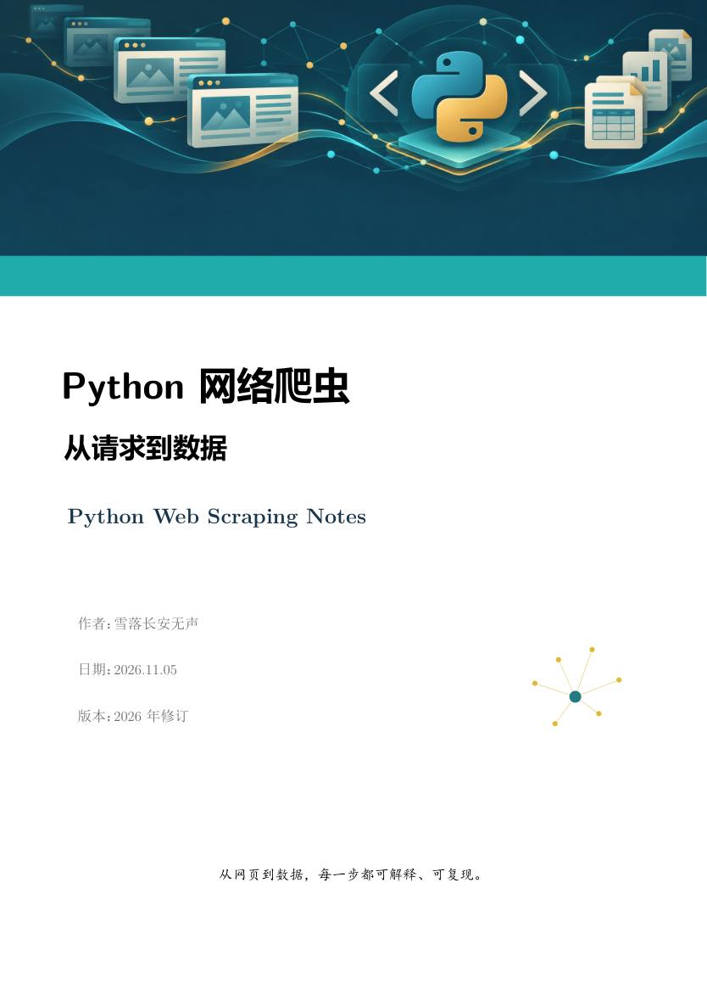
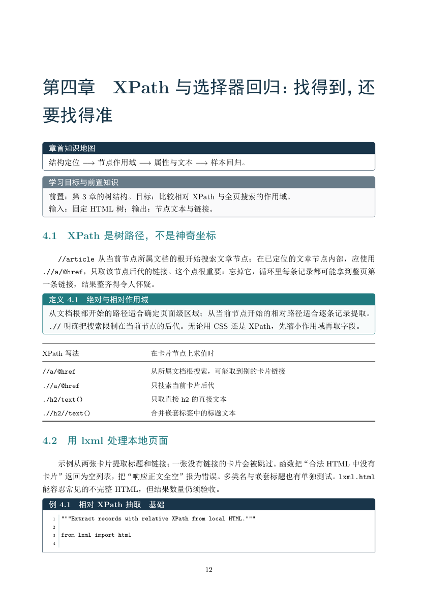
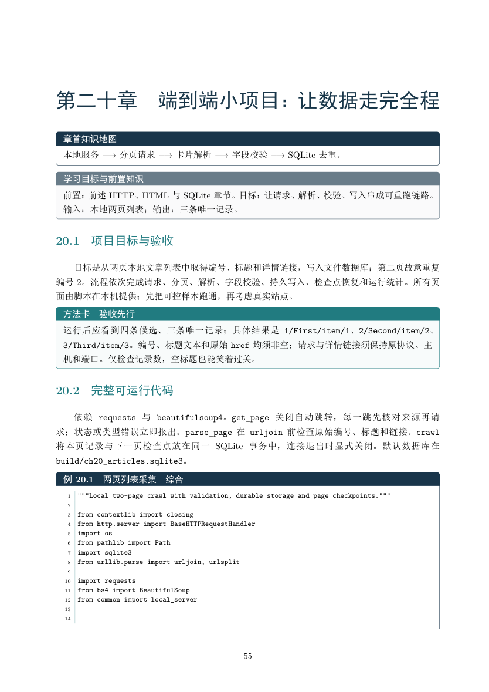

# Python 网络爬虫：从请求到数据

[](main.tex)
[](requirements-lock.txt)
[](https://github.com/qkl12041016s/python-web-scraping-notes/actions/workflows/verify.yml)
[](LICENSE)
[](LICENSE)

**一份能边读边跑的中文网络爬虫讲义：从一条请求出发，走到可验证、可恢复的数据。**

全书 80 页、四部分、22 章。示例使用固定文件和本地 HTTP 服务，适合有 Python 基础、想把“网页能打开”真正变成“数据拿得准”的读者。每章按目标、原理、代码、失败样本、验收和练习展开；代码与讲义分开保存，方便逐行运行。

## 看几页

| 封面 | XPath 作用域 | 本地综合项目 |
|:---:|:---:|:---:|
|  |  |  |

## 这本书写了什么

| 部分 | 章节 | 主线 |
|---|---|---|
| 基础链路 | 1—7 | 字段契约、HTTP、HTML、XPath、JSON 分页、XML/CSV、SQLite |
| 采集进阶 | 8—14 | 并发与异步、动态页面、Scrapy、Pipeline、稳定性与调试 |
| 专题边界 | 15—19 | 会话授权、重试、文件下载、移动端诊断、AST |
| 工程实践 | 20—22 | 本地端到端项目、任务队列边界、测试与运行报表 |

第 20 章把请求、翻页、字段校验、持久存储、中断恢复和统计接成一条完整链路。测试不仅核对记录数，也核对具体编号、标题和链接；空字段、404、跨来源重定向和重复分页都有失败样本。OCR、GraphQL、实时流及真正的分布式队列标为选读，没有用几段概念充当完整实现。

## 下载与目录

到 [Releases](https://github.com/qkl12041016s/python-web-scraping-notes/releases/latest) 下载 `Python-Web-Scraping-Notes.pdf`。如果要运行书中代码，请一并下载 `Python-Web-Scraping-Source.zip`；仓库中的源码与压缩包内容对应。

```text
book_crawler/
├── main.tex、preamble.tex        # 讲义入口与版式
├── frontmatter/                 # 封面、前言、开始之前
├── chapters/                    # 22 章正文
├── appendix/                    # 速查、复现索引、练习思路、参考资料
├── assets/                      # 封面及展示图
├── examples/                    # 每章独立示例与固定样本
├── tests/                       # 成功与失败路径测试
├── docs/                        # 复现矩阵、数据契约和运行检查表
└── requirements-lock.txt        # Python 3.12 完整依赖版本
```

PDF 前面的“开始之前”给出首次运行的完整步骤。各章命令和预期输出见 [复现矩阵](docs/reproducibility_matrix.md)。

## 运行代码

以下命令在项目根目录执行。已验证环境为 Python 3.12、Node.js 22；第 10 章需要 Playwright 浏览器，第 19 章需要 Node 依赖。

```powershell
py -3.12 -m venv .venv
.\.venv\Scripts\python.exe -m pip install -r requirements-lock.txt
cd examples
npm ci
cd ..
.\.venv\Scripts\python.exe -m playwright install chromium
.\.venv\Scripts\python.exe examples/ch01_links.py
.\.venv\Scripts\python.exe -m pytest -q
```

本地验证结果为 **60 项测试通过**。如果 Windows 已安装 Edge，也可设置 `$env:BROWSER_CHANNEL='msedge'` 后直接运行浏览器示例；这时无需另装 Chromium。网络示例只访问本地固定文件或 `127.0.0.1`，不会替你去外站“试试运气”。

## 自行编译

安装 TeX Live、XeLaTeX 与中文字体后，在项目根目录运行：

```powershell
latexmk -xelatex -interaction=nonstopmode -halt-on-error main.tex
```

或连续运行三遍 `xelatex -interaction=nonstopmode -halt-on-error main.tex`。成品为 `main.pdf`。发布前本地三遍编译均成功，日志无错误、未定义引用和 Overfull 警告。

## 许可与致谢

讲义文字、LaTeX 排版及原创配图采用 [CC BY-NC 4.0](LICENSE)；`examples/` 与 `tests/` 中的独立程序采用 [MIT](LICENSE)。转载讲义请署名并注明修改；商业用途请先取得另行授权。第三方名称、商标和资料仍归各自权利人。

感谢书末列出的作者与项目维护者提供了清晰的技术资料。遇到可复现的问题，欢迎附上章节、示例文件和运行环境提交 Issue；能让下一位读者少踩一个坑，就值回票价。
